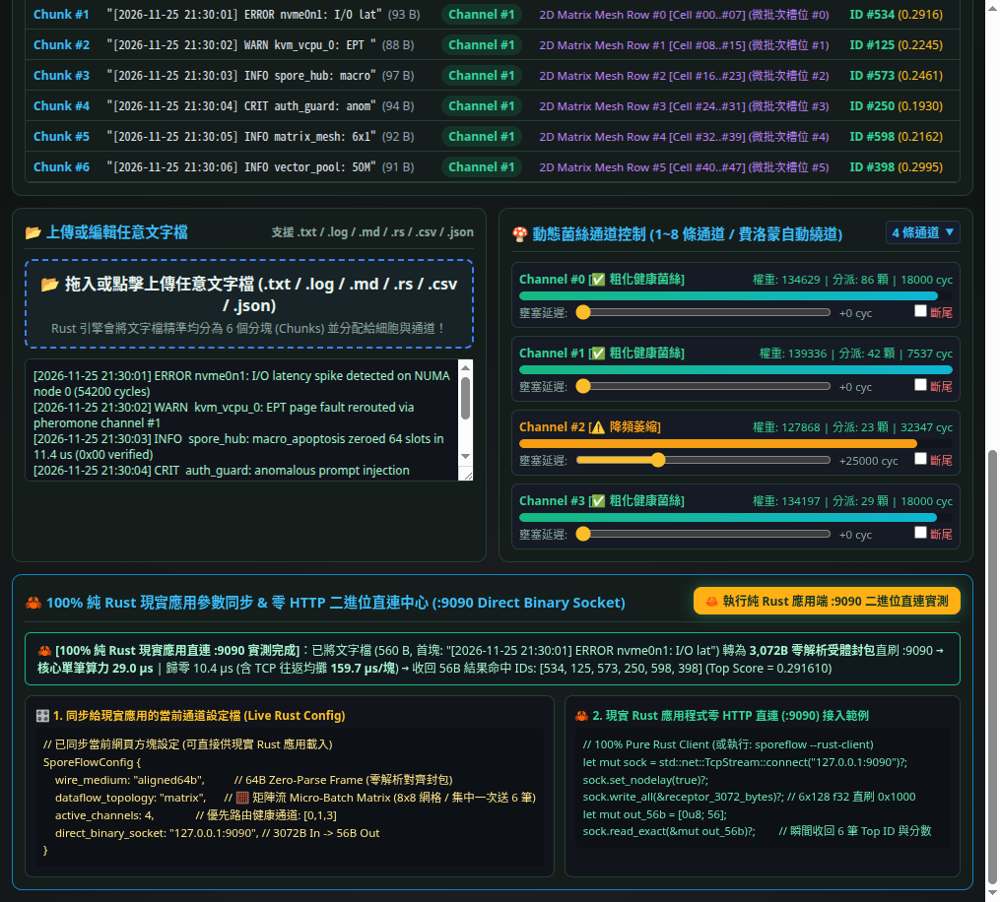

# SporeFlow

**100% Pure Rust co-located sidecar accelerator for zero-copy vector & text-chunk dataflows.**  
Single Fedora 45 container · Read-only `mprotect(PROT_READ)` HugePages vector pool · Raw binary TCP conduit (`:9090`) · Built-in `1.3 KB` `no_std` Rust WebAssembly studio (`:8080`).

[English](./README.md) | [繁體中文](./README.zh-TW.md) | [Contributing](./CONTRIBUTING.md) | [AI / Agent Index (`llms.txt`)](./llms.txt) | [🍄 SporeVault](https://github.com/exefncs2/sporevault) | [🛡️ SporeGuard](https://github.com/exefncs2/sporeguard)



---

## Why SporeFlow?

Traditional vector/feature services spend a large fraction of CPU time parsing JSON, copying heap buffers, and serializing HTTP headers—even when the caller and engine run on the **exact same machine** (e.g., two containers in one Docker/Podman Compose stack).

SporeFlow is an open-source, MIT-licensed building block that strips away that overhead in pure Rust:

- **Zero-HTTP Raw Binary Conduit (`tcp://localhost:9090`)**: Send `3,072 Bytes` (`6 × 128D f32` little-endian, or single `512B`) and immediately receive a `56 Bytes` binary result frame (`6 × u32 IDs + 6 × f32 scores + f32 compute_us + f32 zero_us`).
- **Hardware Read-Only Vector Pool (`POST /v1/pool`)**: Ingest custom vectors (JSON or raw `f32`), L2-normalize into a 50 MB HugePage-backed arena (`MAP_HUGETLB` with `MADV_HUGEPAGE` fallback), and lock the pages with `mprotect(..., PROT_READ)`.
- **Three Selectable Zero-Copy Dataflow Topologies**:
  - **Matrix Mesh (`8 × 8` cells, 6× micro-batch)**: Amortizes memory scan across 6 queries per pass.
  - **Spiking Pipeline (`500` cells, 3-layer adaptive pruning)**: Prunes low-score branches with an adaptive threshold and selectively zeroes only active slices.
  - **Parallel Broadcast (`128` cells)**: Independent 6-chunk evaluation across parallel cell slots.
- **Deterministic `O(1)` Slot Zeroing ("Macrophage Apoptosis")**: Physically zeroes active `0x1000..0x303F` cell scratchpads to `0x00` after every pass (`~11–13 µs` in Matrix mode).
- **Zero-Dependency `1.3 KB` `no_std` Rust Wasm Studio (`http://localhost:8080`)**: Compiled from `src/wasm_frontend.rs` (`wasm32-unknown-unknown`) and embedded directly into the Rust binary via `include_bytes!`. Drop any text file (`.txt`, `.log`, `.md`, `.rs`, `.json`) to inspect chunking, dynamic 1–8 channel pheromone routing, and live `:9090` binary roundtrips.

---

## Measured Benchmarks (Intel i5-6500, 4C4T, Fedora 45 / Podman)

All numbers below are measured directly on local hardware (not extrapolated):

| Workload / Stage | Measured Result | Notes |
| :--- | :--- | :--- |
| Wire ingest to `0x1000` (`6 × 128D f32`) | **JSON**: `35.6 µs` · **64B Zero-Parse**: `38.2 ns` (~930×) · **SHM IPC**: `22.6 ns` (~1,575×) | Pure ingest/deserialization overhead |
| `:9090` Co-located TCP Roundtrip Overhead | `~57 µs` per 6-query micro-batch (`< 2.2%` of total time) | `TCP_NODELAY`, loopback / same-host Docker network |
| End-to-End 6× Matrix Mesh vs Traditional JSON + Heap Copy | `~2,500–2,650 µs/query` amortized vs `~10,900–12,800 µs` (**4.1×–4.8× net speedup**) | Scanning 100,000 × 128D `f32` pool (~50 MB) |
| Physical Cell Slot Zeroing (`0x00` verified) | `~11–13 µs` (Matrix 64 cells) · `~21 µs` (Parallel 128 cells) · `~286 µs` (Pipeline 500 cells) | Selective active-slice wipe |
| Embedded Rust Wasm Frontend | `1.3 KB` (`wasm32-unknown-unknown`, `#![no_std]`) | Zero JS framework dependencies |

### Honest Engineering Boundaries (When to Use / Not Use)

- **Good fit**: Co-located sidecar (same host, `localhost:9090`, or same Docker/Podman network) handling tens of thousands of vector scans or micro-batched text/log routing where compute time dwarfs the `~57 µs` local socket RTT.
- **Not a good fit**: Calling over public internet (tens of milliseconds of WAN RTT will erase any local zero-copy gain) or tiny lookups against a few dozen vectors.
- **KVM status**: `/dev/kvm` runs a lightweight bare-metal probe (`kvm-ioctls`) when available and falls back automatically to the user-space arena on macOS, Windows, or cloud VMs without KVM. Full 64-bit KVM Long Mode execution cells are tracked in the open issues.

---

## Quick Start

### 1. Run the Public Fedora 45 Container (No Rust Toolchain Needed)

```bash
# Docker Hub (shortest)
docker run --rm -it -p 127.0.0.1:8080:8080 -p 127.0.0.1:9090:9090 exefncs2/sporeflow:latest --web

# Linux with /dev/kvm (GHCR)
docker run --rm -it --device /dev/kvm -p 127.0.0.1:8080:8080 -p 127.0.0.1:9090:9090 ghcr.io/exefncs2/sporeflow:latest --web
```

Or run as a sidecar with [compose.yaml](./compose.yaml):

```bash
docker compose up -d
```

Open **`http://localhost:8080`** for the two-page Web Studio:
- **Page 1 (Production Conduit)**: Drop any text file, configure topology & 1–8 pheromone channels, ingest into `/v1/pool`, and test live `:9090` binary roundtrips.
- **Page 2 (Visual Benchmark Arena)**: Side-by-side live comparison against traditional JSON + heap-copy baseline (`1.00×`).

### 2. Run the Built-in Pure Rust Client Test

```bash
docker exec -it sporeflow sporeflow --rust-client
```

### 3. Direct Binary Socket Protocol (`tcp://127.0.0.1:9090`)

```rust
use std::io::{Read, Write};
use std::net::TcpStream;

let mut sock = TcpStream::connect("127.0.0.1:9090")?;
sock.set_nodelay(true)?;
sock.write_all(&receptor_3072_bytes)?; // 6 × 128 f32 little-endian (or 512B single query)

let mut out = [0u8; 56];
sock.read_exact(&mut out)?;
// out[0..24]  -> 6 × u32 best match IDs (LE)
// out[24..48] -> 6 × f32 cosine similarity scores (LE)
// out[48..52] -> f32 kernel compute time (µs, LE)
// out[52..56] -> f32 physical slot zeroing time (µs, LE)
```

### 4. Build Locally from Source (Fedora 45 Multi-Stage Container)

```bash
podman build -t sporeflow:fedora45 -f Containerfile .
podman run --rm -it --device /dev/kvm -p 8080:8080 -p 9090:9090 sporeflow:fedora45 --web
```

---

## Codebase Map

| File | Responsibility |
| :--- | :--- |
| [src/config.rs](./src/config.rs) | 16 KB cell slot layout (`0x0000` DNA, `0x1000` 4 KB receptor `3,136 B`, `0x2000` cytoplasm, `0x3000` 64B-aligned sensor), ports (`8080`, `9090`), and dataflow/wire enums. |
| [src/core.rs](./src/core.rs) | `SharedReadOnlyVectorPool` (`MAP_HUGETLB`/`MADV_HUGEPAGE` + `mprotect(PROT_READ)`), FNV-1a N-gram text chunker, `PheromoneRoutingTable` (1–8 channels), KVM probe, and Parallel/Pipeline/Matrix engines. |
| [src/wasm_frontend.rs](./src/wasm_frontend.rs) | `#![no_std]` `wasm32-unknown-unknown` frontend (`1.3 KB`) that packs browser text into `3,072 B` receptor binary frames. |
| [src/main.rs](./src/main.rs) | Dual-stack `[::]:8080` HTTP/API server (`/v1/pool`, `/v1/conduit`, `/v1/rust-client-test`), `:9090` raw binary TCP conduit, `--rust-client` CLI, and embedded two-page Web Studio. |
| [Containerfile](./Containerfile) | Multi-stage Fedora 45 build (`fedora:45` -> `fedora-minimal:45`), zero host toolchain required. |

---

## Contributing & Roadmap

SporeFlow is designed to be a minimal, hackable foundation (only 4 Rust source files, 3 crates: `libc`, `kvm-ioctls`, `kvm-bindings`). Check out [CONTRIBUTING.md](./CONTRIBUTING.md) and our open [`help wanted` / `good first issue`](https://github.com/exefncs2/sporeflow/issues) items—including ARM64/NEON support, `/dev/shm` ring IPC, 64-bit KVM Long Mode cells, Int8/FP16 quantization, and Prometheus `/metrics`.

Licensed under the MIT License (`SPDX-License-Identifier: MIT`).
