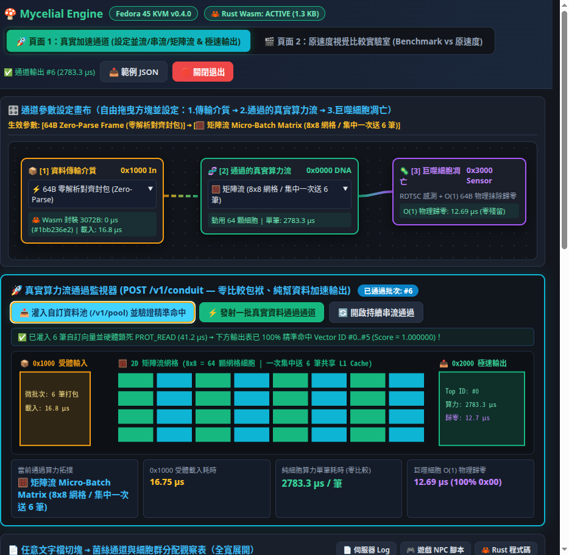

# SporeFlow（繁體中文說明）

[English](./README.md) | [繁體中文](./README.zh-TW.md) | [貢獻指南](./CONTRIBUTING.md) | [AI / Agent 索引 (`llms.txt`)](./llms.txt)



---

## 一、 專案背景與版本演進

SporeFlow 起源於一個實驗性問題：**在同一台主機（或同一個 Docker / Podman Compose 網路）內，能否用極簡的純 Rust Sidecar 容器，把「JSON 解析＋逐筆 Heap 拷貝＋HTTP 封裝」吃掉的延遲砍掉，直接提供微秒級零拷貝向量與文字分塊資料流？**

本專案經過四個階段實作與實測修正：
1. **v0.1（裸機細胞記憶體模型）**：在 Fedora 45 容器內建立 16KB 固定槽位（`0x0000` DNA、`0x1000` 4KB 受體、`0x2000` 細胞質、`0x3000` 64B 對齊感測器）與 50MB 大頁唯讀向量池（`mprotect(PROT_READ)`），並加入 `/dev/kvm` 探測與 User-Space 自動降級。
2. **v0.2（三大算力流與動態通道）**：實作並流（128 核）、串流（500 核 3 層自適應剪枝）、矩陣流（8×8 網格 6× 微批次）與 1~8 條費洛蒙動態路由（降頻懲罰與斷尾隔離）。
3. **v0.3（雙頁面工作台與對外接口）**：拆分「頁面 1：真實加速通道」與「頁面 2：原速度視覺比較實驗室」，新增 `POST /v1/pool`、`POST /v1/conduit` 以及零 HTTP 純二進位直連埠 `tcp://localhost:9090`。
4. **v0.4（100% 純 Rust 前後端與實測除錯定稿）**：加入 `1.3 KB` `#![no_std]` Rust WebAssembly 前端（`wasm32-unknown-unknown`）與內建 `--rust-client` 實測器，修正文字均分切塊、串流自適應門檻、選擇性 `O(1)` 歸零與 Dual-Stack `[::]:8080` 連線問題，正式定名為 **SporeFlow**。

---

## 二、 實際程式碼結構、實測數據與限制

### 1. 檔案對照（僅 4 個 Rust 原始碼檔、3 個 Crate 依賴）

| 檔案路徑 | 實際實作內容 |
| :--- | :--- |
| [src/config.rs](./src/config.rs) | 定義 16KB 細胞槽位常數、`CellReceptorInput`（`3,136 Bytes <= 4096 Bytes`）、`:8080` 與 `:9090` 埠號、資料流與傳輸介質列舉。 |
| [src/core.rs](./src/core.rs) | 實作 `SharedReadOnlyVectorPool`（`MAP_HUGETLB` 失敗降級 `MADV_HUGEPAGE`，灌入後鎖定 `PROT_READ`）、FNV-1a N-gram 文字均分切塊器、`CellSlotArena` 與選擇性 `O(1)` 物理歸零、`PheromoneRoutingTable`（1~8 通道）、KVM 探測，以及並流／串流／矩陣流核心。 |
| [src/wasm_frontend.rs](./src/wasm_frontend.rs) | `#![no_std]` Rust WebAssembly 前端核心（編譯後 `1.3 KB`），於瀏覽器內直接將任意文字切塊並打包為 `3,072B` 受體封包。 |
| [src/main.rs](./src/main.rs) | Dual-Stack `[::]:8080` 多執行緒 HTTP/API 伺服器（`/v1/pool`、`/v1/conduit`、`/v1/rust-client-test`）、`:9090` 零 HTTP 純二進位直連埠（`3,072B In -> 56B Out`）、`--rust-client` CLI 與雙頁面 Web Studio。 |
| [Containerfile](./Containerfile) | Fedora 45 多階段建置（Stage 1 編譯 Wasm 與 Release 執行檔；Stage 2 封裝至 `fedora-minimal:45`），本機無須安裝 Rust。 |
| [compose.yaml](./compose.yaml) | 同機 Sidecar 一鍵啟動設定檔。 |

### 2. 本機實測數據（Intel i5-6500 4C4T · Fedora 45 / Podman）

- **傳輸介質轉檔進 `0x1000`（6×128 維 `f32`）**：JSON `35.6 µs` vs 64B Zero-Parse `38.2 ns`（~930 倍） vs SHM IPC `22.6 ns`（~1,575 倍）。
- **`:9090` 同機純二進位 TCP 往返開銷**：約 `~57 µs`（佔整體時間 `< 2.2%`）。
- **端到端 6× 矩陣流淨加速**：掃描 10 萬筆 128 維向量（~50 MB 唯讀池）均攤約 `2,500–2,650 µs/筆`，對比傳統 JSON + 逐筆 Heap 拷貝（`10,900–12,800 µs/筆`）實測淨賺 **4.1×–4.8×**。
- **巨噬細胞 `O(1)` 物理歸零（100% 驗證 `0x00`）**：矩陣流 64 細胞 `~11–13 µs`、並流 128 細胞 `~21 µs`、串流 500 細胞 `~286 µs`。

### 3. 誠實的適用邊界與目前限制

- **適合的場景**：**同機 Sidecar**（同主機 `localhost:9090` 或同一 Docker/Podman 網路），處理數萬筆向量掃描或 6 筆微批次矩陣流，計算耗時遠大於本地 `~57 µs` Socket 往返。
- **不適合的場景**：跨公網 API 呼叫（數十毫秒 WAN RTT 會吃光零拷貝紅利），或僅掃描幾十筆向量的極小請求。
- **目前限制**：目前 KVM 模組僅執行輕量級裸機探測，主算力執行於 User-Space Arena（真 64-bit KVM Long Mode 細胞與 `/dev/shm` Ring IPC 已列於 GitHub Issues 徵求社群共建）；文字轉向量為輕量 FNV-1a N-gram 特徵雜湊，方便測試與路由觀察，正式語意檢索請直接由外部傳入 Embedding 浮點向量。

---

## 三、 正式安裝與使用方式

### 1. 直接拉取公開映像檔啟動（推薦，免編譯、免裝 Rust）

```bash
# Linux 主機（掛載 /dev/kvm）
docker run --rm -it --device /dev/kvm -p 8080:8080 -p 9090:9090 ghcr.io/exefncs2/sporeflow:latest --web

# macOS / Windows / 無 KVM 雲端主機（自動降級 User-Space 沙盒）
docker run --rm -it -p 8080:8080 -p 9090:9090 ghcr.io/exefncs2/sporeflow:latest --web
```

或使用 [compose.yaml](./compose.yaml) 作為同機 Sidecar：

```bash
docker compose up -d
```

啟動後開啟 **`http://localhost:8080`** 即可操作雙頁面工作台。

### 2. 執行內建 100% 純 Rust 客戶端實測（`--rust-client`）

```bash
docker exec -it sporeflow sporeflow --rust-client
```

### 3. 外部 Rust 程式直連 `:9090` 範例

```rust
use std::io::{Read, Write};
use std::net::TcpStream;

let mut sock = TcpStream::connect("127.0.0.1:9090")?;
sock.set_nodelay(true)?;
sock.write_all(&receptor_3072_bytes)?; // 6 × 128 維 f32 Little-Endian（或單筆 512B）

let mut out_56b = [0u8; 56];
sock.read_exact(&mut out_56b)?;        // 瞬間收回 6 筆 Top ID、餘弦分數與耗時
```

### 4. 從原始碼本地建置 Fedora 45 映像檔

```bash
podman build -t sporeflow:fedora45 -f Containerfile .
podman run --rm -it --device /dev/kvm -p 8080:8080 -p 9090:9090 sporeflow:fedora45 --web
```

授權條款：MIT（`SPDX-License-Identifier: MIT`）。
